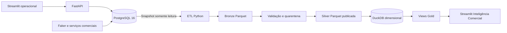

# Pastel da Casa — CRM & Data Pipeline

Pipeline local de Engenharia de Dados que transforma uma operação comercial simulada em análises de vendas: **PostgreSQL → Python ETL → Parquet Bronze/Silver → DuckDB → Gold → Streamlit**.

Projeto educacional de portfólio para uma fabricante e distribuidora fictícia de massas de pastel. Clientes, vendedores e vendas foram criados para demonstração; os dados sintéticos não representam operações reais. Arquivos de dados, credenciais, ambientes virtuais e backups não integram a entrega Git.

## O que foi implementado

| Área | Entrega e competência demonstrada |
| --- | --- |
| Origem transacional | CRM FastAPI/Streamlit com clientes, produtos, vendedores, pedidos e estoque transacional em PostgreSQL |
| Dados históricos | Gerador reprodutível por seed, lotes, retomada e movimentações rastreáveis |
| ETL Python | Snapshot consistente, carga FULL/incremental, tipagem, qualidade, quarentena e publicação Bronze/Silver |
| Data Warehouse | Modelo dimensional DuckDB, chaves substitutas estáveis, SCD1 e fato por item faturado |
| Analytics | Views Gold e dashboard Streamlit com filtros parametrizados e reconciliação financeira |
| Orquestração | Prefect, tasks, worker/pool, cron, retries seletivos, idempotência e controle de concorrência |
| Confiabilidade | Testes de integração, falhas injetadas, recuperação e preservação de dados |

**Validação local registrada:** 160 testes e 33 subtestes aprovados. A demonstração histórica alcançou 20.000 pedidos sintéticos; os dados não são distribuídos neste repositório. [Resultados e alcance dos testes](docs/VALIDATION.md).

Para revisar o portfólio: comece pela [arquitetura](docs/architecture.md), explore o [modelo dimensional](docs/data-dictionary.md), os [contratos da ETL](etl/README.md) e a [orquestração](orchestration/README.md). Depois consulte os testes junto de cada módulo.

## Problema e objetivo de negócio

Cadastros, pedidos e estoque atendem à operação, mas não bastam para analisar evolução de receita, produtos, vendedores e recorrência. O projeto separa as transações do consumo analítico, preserva preços históricos e publica conjuntos de dados verificáveis para apoiar essas análises.

O foco técnico é extração consistente, qualidade, idempotência, recuperação de falhas, modelagem dimensional e rastreabilidade. O CRM fornece a origem transacional e permite exercitar mudanças incrementais.

## Arquitetura



O Streamlit operacional usa Requests/FastAPI; a área analítica consulta apenas Gold em conexão DuckDB somente leitura. PostgreSQL não é consultado pelo dashboard analítico. [Arquitetura e fluxo completo](docs/architecture.md).

## Tecnologias e estrutura

Python (ambiente validado em 3.14), FastAPI, SQLAlchemy, Pydantic, PostgreSQL 16, Docker Compose, Faker, Pandas, PyArrow/Parquet, DuckDB, Streamlit, Requests, Plotly, Prefect 3.9.1 e pytest/unittest/AppTest.

```text
backend/                  API, schemas, serviços e migrações
database/oltp/            DDL e seed inicial
database/migrations/      Migrações incrementais SQL
frontend/                 CRM Streamlit
frontend/analytics/       Dashboard analítico e consultas Gold
scripts/synthetic_data/   Gerador, validações e rastreabilidade
orchestration/            Flows/tasks Prefect, worker, monitor e testes
etl/                      Extração, qualidade, transformação e publicação
warehouse/                Dimensões, fato, views Gold e carga DuckDB
docs/                     Arquitetura, execução, qualidade e publicação
docs/screenshots/         Instruções para adicionar capturas reais
requirements.txt          Agregador das dependências por módulo
data/ e backups/          Artefatos locais ignorados pelo Git
```

## Engenharia de Dados

**Bronze:** extrações tipadas com metadados de execução, origem e hash. **Silver:** tabelas validadas, quarentena com motivos e vendas detalhadas derivadas. Publicações versionadas usam um manifesto autoritativo; arquivos parciais não são tratados como versões publicadas.

**FULL:** estabelece a fotografia completa e a base de controle. **INCREMENTAL:** combina janela inclusiva de timestamps, reconciliação integral de IDs/hashes e upsert por chave. Captura commits tardios, datas iguais e inserções históricas. Não é CDC e ainda lê a origem inteira para reconciliação; reduz o conjunto incremental persistido, não garante extração proporcional apenas às mudanças.

**Idempotência:** run_id, chaves de negócio/técnicas, hashes e checkpoints permitem repetição e retomada. A Bronze validada pode ser reutilizada após falha. Watermarks avançam junto da publicação completa; uma execução antiga não pode substituir uma versão mais nova. [Carga incremental e recuperação](docs/incremental-and-recovery.md).

**DuckDB:** quatro dimensões (cliente, produto, vendedor, tempo), SKs estáveis e SCD1 nas dimensões cadastrais. A fato tem uma linha por item de pedido faturado. Preço, desconto e valor líquido históricos não são recalculados pelo catálogo atual. FULL/INCREMENTAL reconciliam a Silver publicada dentro de transação. [Modelo e dicionário](docs/data-dictionary.md).

## CRM e indicadores

O CRM oferece produtos (cadastro, edição e desativação), clientes, vendedores, pedidos com itens, faturamento e cancelamento de pendentes. Faturar bloqueia e revalida os registros, baixa estoque e registra saídas na mesma transação. Não permite estoque negativo ou faturamento repetido. Não há emissão fiscal, cobrança ou estorno de faturados.

A Inteligência Comercial apresenta receita líquida, pedidos distintos, ticket médio, linhas e unidades faturadas; evolução mensal, top produtos por unidades, receita por vendedor/UF, recorrência e detalhes paginados. Todos os recortes usam filtros SQL parametrizados de período inclusivo UTC, vendedor, produto e UF.

Ticket = receita do recorte / pedidos distintos; recorrente = cliente com pelo menos dois pedidos no recorte. Com filtro por produto, receita e ticket incluem apenas os itens selecionados. A UF usa o cadastro corrente (SCD1). [Contratos analíticos](frontend/analytics/README.md).

## Executar localmente

Pré-requisitos: Python 3.14 (versão validada), Docker Desktop com Compose e WSL2 no Windows, porta 5432 disponível. Os comandos abaixo são PowerShell, a partir da raiz. Não sobrescreva um .env ou volume já existente.

```powershell
py -3.14 -m venv .venv314
.\.venv314\Scripts\python.exe -m pip install -r requirements.txt
if (!(Test-Path .env)) { Copy-Item .env.example .env }
```

Edite a senha demonstrativa no seu .env **antes da primeira inicialização**. O backend lê POSTGRES_USER, POSTGRES_PASSWORD e POSTGRES_DB. Os nomes técnicos legados são intencionais para preservar compatibilidade; a marca é Pastel da Casa. Em um volume já inicializado, mudar .env não muda a senha do PostgreSQL.

```powershell
docker volume create pastelflow-crm_postgres_data
docker compose up -d
docker compose ps
.\.venv314\Scripts\python.exe backend/migrate.py
```

O volume externo é necessário numa instalação nova. DDL e seed são aplicados somente quando o volume está vazio; não reaplique os scripts manualmente. Migrações são transacionais, registradas por versão/checksum e preservam os gatilhos.

Em dois terminais separados:

```powershell
# API
.\.venv314\Scripts\python.exe -m uvicorn app.main:app --app-dir backend --reload
```

```powershell
# CRM e Inteligência Comercial
.\.venv314\Scripts\python.exe -m streamlit run frontend/app.py --server.address 127.0.0.1
```

CRM: http://127.0.0.1:8501 · Swagger: http://127.0.0.1:8000/docs · Saúde: http://127.0.0.1:8000/health.
Encerre servidores com Ctrl+C. Configuração opcional por variável de ambiente do terminal: API_BASE_URL (padrão http://127.0.0.1:8000) e WAREHOUSE_DB_PATH (padrão data/warehouse/pastel_da_casa.duckdb). Esses valores não são automaticamente lidos de .env pelo frontend.

### Dados opcionais e pipeline

Teste descartável do gerador (precisa de PostgreSQL e permissão CREATE SCHEMA; o schema é removido ao concluir):

```powershell
.\.venv314\Scripts\python.exe -m scripts.synthetic_data --isolated --execute --clientes 20 --vendedores 3 --produtos 8 --pedidos 40 --start 2025-11-05 --end 2026-11-05 --seed 42 --batch-size 10
```

Essa execução isolada **não preenche o CRM**. Para popular uma instalação nova, revise primeiro o plano abaixo. Acrescente --execute somente após decidir persistir o lote e ter backup; preserve o mesmo run_id e parâmetros para retomar. Não repita a carga histórica de 20.000 pedidos numa instalação que já a possui.

```powershell
.\.venv314\Scripts\python.exe -m scripts.synthetic_data --development --clientes 20 --vendedores 3 --produtos 8 --pedidos 40 --start 2025-11-05 --end 2026-11-05 --seed 42 --batch-size 10
```

Depois de autorizar as cargas locais, construa as camadas (os comandos abaixo gravam artefatos):

```powershell
.\.venv314\Scripts\python.exe -m etl --mode full --execute --allow-full
.\.venv314\Scripts\python.exe -m warehouse --mode full --execute --allow-persistent
```

Após mudanças no CRM, feche leitores do DuckDB durante sua atualização:

```powershell
.\.venv314\Scripts\python.exe -m etl --mode incremental --execute
.\.venv314\Scripts\python.exe -m warehouse --mode incremental --execute --allow-persistent
```

Reabra o Streamlit → Inteligência Comercial → Atualizar indicadores.
Sem DW publicado, a interface orienta a carga; não preenche gráficos com dados fixos.
Sem --execute, as CLIs de geração, ETL e warehouse apenas mostram planos.
[Guia de operação e recuperação](docs/runbook.md).

## Testes

A suíte completa usa PostgreSQL com permissão CREATE SCHEMA, schemas descartáveis, DuckDB temporário e um Prefect Server de teste. Não exige os arquivos privados da demonstração nem utiliza o worker operacional. O baseline FULL de replay existe somente no ambiente descartável.

```powershell
.\.venv314\Scripts\python.exe -m pip install -r orchestration/requirements-dev.txt
.\.venv314\Scripts\python.exe -B -m orchestration.tests.run_suite
```

O comando registra JUnit e verificações de preservação em uma pasta temporária e falha se detectar mudança nos dados principais, sequências ou `.env`. [Auditoria da release](docs/VALIDATION.md). Os relatórios anteriores permanecem como evidência histórica.

## SQL e demonstração

Consultas em [warehouse/sql/examples.sql](warehouse/sql/examples.sql):

```sql
SELECT * FROM gold_kpis;
SELECT * FROM gold_faturamento_mensal ORDER BY ano, mes;
SELECT * FROM gold_produtos_mais_vendidos ORDER BY posicao, id_produto LIMIT 10;
SELECT * FROM gold_clientes_recorrentes ORDER BY faturamento DESC, id_cliente LIMIT 20;
```

Demonstração visual: [roteiro e capturas pendentes](docs/images/README.md).
Não há imagens de aplicação versionáveis disponíveis nesta pasta; os espaços são documentados,
sem inventar screenshots ou reutilizar imagens de outros sistemas.

A base local de demonstração atingiu 20.000 pedidos. Esse é um resultado local documentado,
não um dataset distribuído nem uma meta de desempenho. Relatórios históricos:
[geração](scripts/synthetic_data/FULL_LOAD_RESULT.md),
[ETL](etl/VALIDATION_REPORT.md), [DW](warehouse/VALIDATION_REPORT.md),
[dashboard](frontend/analytics/VALIDATION_REPORT.md).

## Limitações e próximos passos

Execução local, um escritor, sem alta disponibilidade, CDC, processamento distribuído, autenticação de produção ou deploy automatizado. Reconciliação integral tem custo linear. SCD1 não preserva alterações históricas dos cadastros. Persistência e leituras simultâneas DuckDB podem conflitar; feche leitores durante a carga. OneDrive não é protocolo de publicação distribuída: prefira disco local para artefatos em execução. Dependências por intervalo não equivalem a um lockfile reproduzível por hash.

Melhorias futuras possíveis: CI isolada, lockfile multiplataforma, métricas de operação, SCD2 e política de retenção. Não estão implementadas nesta entrega.

## Orquestração e monitoramento

Prefect 3.9.1 coordena seis tasks: origem PostgreSQL, ETL, validação Silver, atualização dimensional, reconciliação Gold e auditoria. Há retries seletivos, exclusão de escritores por destino e retomada por ID lógico. O cron diário é `10 15 * * *`, em `America/Sao_Paulo` (15h10).

O registro em uma instalação nova permanece pausado até ativação explícita. No ambiente local, a agenda foi autorizada e a primeira carga automática terminou com seis tasks Completed em 45,415 segundos, sem novos dados. Isso é uma medição local, não uma garantia de desempenho. O código versionado não transporta o estado ativo do servidor.

```powershell
# Plano offline, sem cargas
.\.venv314\Scripts\python.exe -m orchestration --dry-run
```

Siga o [guia operacional](orchestration/WORKER.md) para servidor, pool, worker, deployment, validação, pausa e retomada. O [guia técnico](orchestration/README.md) detalha retries e recuperação. Não execute `register` sobre uma agenda ativa: ele a pausa por segurança. A recuperação não constitui uma transação distribuída entre Silver e DuckDB.

Resultados: [incremental](orchestration/INCREMENTAL_RUN_RESULT.md), [recuperação](orchestration/RECOVERY_VALIDATION.md), [automação](orchestration/AUTOMATION_VALIDATION.md), [primeira execução automática](orchestration/FIRST_AUTOMATIC_RUN.md).

## Repositório e segurança

[eduardostr/pastel-dacasa-data-engineering](https://github.com/eduardostr/pastel-dacasa-data-engineering) contém código, testes, SQL de schema/seed demonstrativo e documentação. Este checkout tem histórico novo; não importa o histórico Git de outro repositório.

Credenciais são fornecidas localmente por `.env`/ambiente. `.env.example` contém apenas placeholders. Dados, backups, logs, bancos DuckDB, Parquet, ambientes virtuais e estado Prefect não são distribuídos. [Configuração segura e limitações](docs/SECURITY.md).

## Licença

Distribuído sob a [licença MIT](LICENSE).
