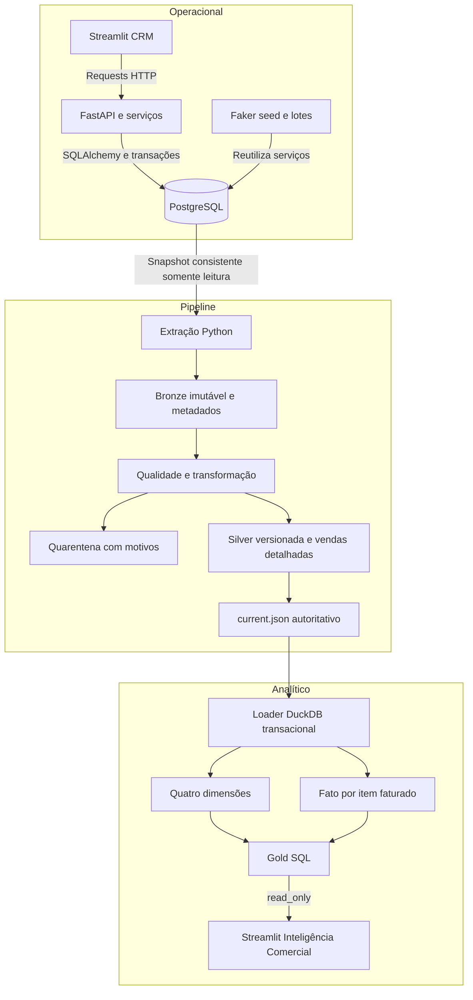
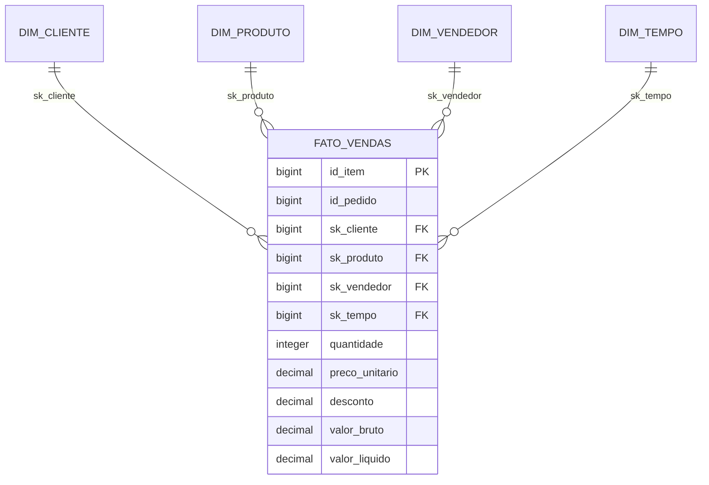
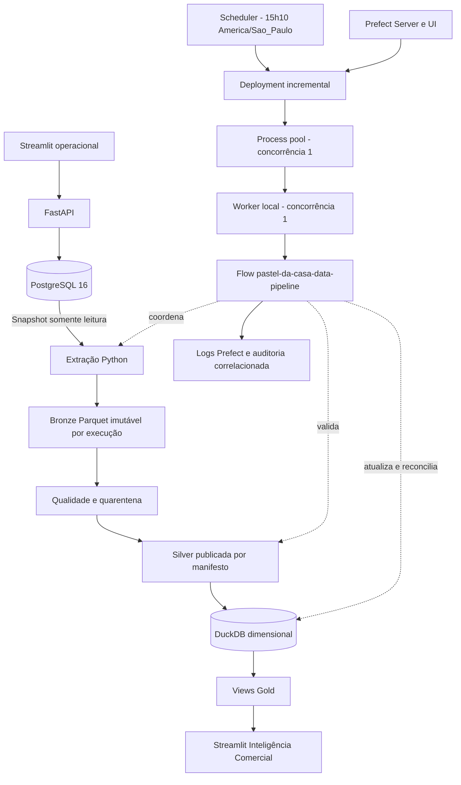

# Arquitetura e fluxo de dados

## Componentes

## Fluxo ponta a ponta

1. Cadastro e pedidos entram pela API; faturamento preserva preço dos itens e confirma status, baixa e movimento juntos.
2. A ETL fixa um snapshot da origem. FULL extrai tudo; incremental reconcilia chaves/hashes e janela temporal.
3. Bronze mantém rastreabilidade; validações encaminham rejeições para quarentena e evitam vendas parciais.
4. Silver é publicada com manifesto, hashes, contagens e watermarks. O consumidor fixa uma única versão.
5. O DW verifica a publicação e reconcilia dimensões e fato em transação. Publicação repetida pode retornar REUSED.
6. Gold agrega medidas históricas. Streamlit filtra por parâmetros SQL, pagina detalhes e encerra conexões.
7. Depois de ETL e DW atualizados, o usuário atualiza os indicadores. O dashboard não inicia cargas.

PostgreSQL é a origem transacional; Parquet é a persistência versionada do pipeline; DuckDB é a persistência dimensional local. Gold são views, não arquivos Parquet adicionais. Logs/auditorias e manifestos registram tentativas; não substituem backup.

## Modelo dimensional

Grão: item de pedido FATURADO. Vários itens podem ter o mesmo id_pedido; contagem de pedidos é distinta.
Dimensões cadastrais são SCD1, com SKs estáveis. Tempo é calendário UTC contínuo no intervalo de pedidos.
Pedidos pendentes/cancelados permanecem no operacional/Silver, mas não compõem receita na fato.

## Orquestração — Etapa 11

Prefect encadeia origem → ETL → validação Silver → warehouse → validação Gold → relatório. Não substitui os contratos, transações ou checkpoints existentes. O deployment diário está preparado e inativo; [operação, falhas e limites](../orchestration/README.md).

Na Etapa 11.3, o Prefect Server encaminha runs ao pool Process (limite 1); o worker inicia o mesmo flow no venv local. O deployment diário está registrado, pausado e com schedule inativo. [Arquitetura operacional e lifecycle](../orchestration/WORKER.md).

## Operação completa com Prefect — v1.1.0

O scheduler enfileira execuções; o worker precisa estar online para executá-las. O registro inicial mantém a agenda pausada. Locks nativos protegem os destinos também nas chamadas manuais. ETL e DW mantêm seus mecanismos de publicação e retomada; não há commit distribuído entre os componentes. Bronze/Silver, metadados, DW, logs e estado Prefect são locais e ignorados pelo Git.

> Arquivos JSON de resultados citados são artefatos locais não distribuídos. O alcance da validação está resumido em VALIDATION.md.
