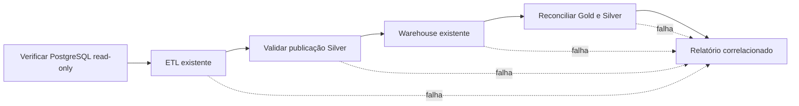

> Guia técnico e evidências históricas locais. Este clone não transporta servidor, worker ou agenda ativos; configure os serviços conforme as instruções.

# Orquestração Prefect — Etapa 11

Prefect **3.9.1**, instalado e testado em Python 3.14. Atua como adaptador dos componentes existentes:
`etl.pipeline.Pipeline.run`, `warehouse.loader.Warehouse.run` e validadores do warehouse.
Não reimplementa transformações, watermarks, tabelas ou views.

## Arquitetura



- `flows/pipeline.py`: flow pastel-da-casa-data-pipeline, sequência e locks.
- `tasks/pipeline.py`: seis tasks, logs JSON, retries seletivos e adaptadores.
- `config/`: destinos, modo, guardas e IDs estáveis.
- `deployment.py`: cron diário preparado, sempre pausado/inativo.
- `tests/`: testes isolados e integração real com servidor Prefect temporário.

## Instalação e servidor local

Na raiz do projeto, PowerShell:

```powershell
.\.venv314\Scripts\python.exe -m pip install -r requirements.txt
$env:PREFECT_HOME = (Join-Path (Get-Location) ".prefect")
$env:PREFECT_SERVER_ANALYTICS_ENABLED = "false"
.\.venv314\Scripts\prefect.exe server start --host 127.0.0.1 --port 4200
```

UI: **http://127.0.0.1:4200**. O servidor serve a API em /api.
Mantenha esse terminal aberto. Em outro terminal, na mesma raiz:

```powershell
$env:PREFECT_HOME = (Join-Path (Get-Location) ".prefect")
$env:PREFECT_SERVER_ANALYTICS_ENABLED = "false"
$env:PREFECT_API_URL = "http://127.0.0.1:4200/api"
```

Não use Prefect Cloud nem configure tokens para esta instalação local.
O estado do Prefect fica em .prefect/ (ignorado pelo Git); não usa o PostgreSQL comercial.
Nenhum servidor permanente foi iniciado nesta entrega. Os testes iniciaram e encerraram um servidor temporário.
O pip resolveu FastAPI para 0.150.0 e websockets para 16.1.1 conforme restrições do Prefect;
os 110 testes de regressão foram executados após essa resolução, sem falhas.
O código da API não foi alterado. Dependências completas continuam declaradas por módulo.

## Execução manual e guardas

Plano offline, sem importar o runtime Prefect, sem conexão ou arquivos de dados:

```powershell
.\.venv314\Scripts\python.exe -m orchestration --dry-run
.\.venv314\Scripts\python.exe -m orchestration --mode full --dry-run
```

Validação somente leitura da origem e das publicações existentes (exige Silver e DW já reconciliados):

```powershell
.\.venv314\Scripts\python.exe -m orchestration --validate-only
```

validate-only consulta a origem e valida hashes, schema, regras Silver e reconciliação Gold.
Não extrai dados, publica datasets, cria locks de destino ou grava relatório no data/.
A execução ainda aparece no histórico do servidor Prefect e pode criar estado técnico do Prefect.
dry-run via CLI não inicia servidor nem cria histórico. Dentro do flow Python, dry_run cria apenas
o registro técnico Prefect, sem tasks de dados.

**Somente depois de autorização para cargas persistentes**, com leitores DuckDB fechados:

```powershell
$jobRunId = [guid]::NewGuid().ToString()
.\.venv314\Scripts\python.exe -m orchestration --mode incremental --allow-persistent --run-id $jobRunId
```

Para baseline FULL autorizado, acrescente a guarda adicional:

```powershell
.\.venv314\Scripts\python.exe -m orchestration --mode full --allow-persistent --allow-full --run-id $jobRunId
```

Não execute ambas as linhas como sequência automática: escolha o modo adequado.
INCREMENTAL é o padrão e exige baseline anterior da ETL e do DW.
Sem --dry-run, --validate-only ou --allow-persistent, a CLI rejeita a execução.
Flags técnicas não substituem a decisão do proprietário sobre gravar dados.
.env é preservado; a conexão usa a configuração já existente da ETL.

## Configuração por ambiente

| Variável | Padrão |
| --- | --- |
| PASTEL_DATA_DIR | raiz/data |
| PASTEL_DW_PATH | raiz/data/warehouse/pastel_da_casa.duckdb |
| PASTEL_SOURCE_SCHEMA | public |
| PASTEL_MAX_ATTEMPTS | 3 (intervalo permitido 1–3) |
| PASTEL_RETRY_SECONDS | 10 |
| PASTEL_CRON | 10 15 * * * |
| PASTEL_TIMEZONE | America/Sao_Paulo |
| PREFECT_API_URL | configure explicitamente http://127.0.0.1:4200/api |
| PREFECT_HOME | configure .prefect/ local e ignorado |

A origem é verificada em transação PostgreSQL somente leitura; são confirmadas as seis tabelas.
Silver reutiliza load_publication, hashes, schemas e validate_source.
Gold é aberta read_only, com tabelas apenas TEMP para reutilizar validate_source/validate_target e
as regras de dimensão/fato. Versão/fingerprint devem corresponder à Silver validada.
Valores financeiros, contagem de itens/pedidos e relacionamentos são reconciliados.
Quarentena não é transformada em aprovação silenciosa: as regras de consistência existentes são executadas;
métricas de rejeição da ETL permanecem no relatório.

## Agendamento preparado e desativado

Inspecione o plano sem registrar nada:

```powershell
.\.venv314\Scripts\python.exe -m orchestration.deployment
```

Configuração: 15h10 diária, America/Sao_Paulo, incremental, cron inativo,
deployment pausado, limite global/local 1. Nenhum deployment foi registrado nesta entrega.

Após autorização para registrar um deployment **ainda pausado**, com servidor local aberto:

```powershell
.\.venv314\Scripts\python.exe -m orchestration.deployment --serve
```

Esse comando mantém um runner local aberto, usando flow.serve, paused=True e Cron(active=False).
Não ativa agenda. Registro e habilitação são decisões distintas. Após autorização específica para recorrência,
o proprietário poderá habilitar o deployment e o schedule na UI; o runner precisa continuar funcionando.
Não foi preparado serviço Windows que reinicie automaticamente.
O deployment incremental tem allow_persistent=True para execuções futuras autorizadas; ativá-lo autoriza gravações
nos destinos configurados. Não o habilite apenas para testar a UI.

## Retentativas e retomada

Tasks de dados: no máximo três tentativas totais (duas retentativas), intervalo configurável.
Somente erros identificados como transitórios permitem retry: falhas de conexão apropriadas,
SQLSTATE de conexão/serialização/deadlock e bloqueio transitório do DuckDB.
Erros de validação, autenticação e permissões não recebem repetição indiscriminada.
Colisão do lock do flow falha imediatamente e fica registrada; não remove locks nem inicia outra escrita.
O flow não tem retry automático integral; a task de finalização também não.

Mesmo run_id de orquestração deriva IDs UUID5 fixos de ETL e DW. Retente com o mesmo run_id e modo para
reutilizar Bronze/checkpoints e reconciliação existentes. Um novo run_id significa uma nova execução lógica.
Se uma publicação mais nova surgir, não force a antiga por cima: as guardas existentes rejeitam retrocesso.

**Fronteiras de commit:** não existe transação distribuída entre Parquet/manifesto e DuckDB.
Falha na ETL preserva seu watermark/publicação anterior; falha posterior no DW não desfaz uma Silver
já publicada corretamente. Nesse caso o DW anterior continua válido, mas pode ficar atrasado em relação
à Silver; retome o mesmo job para completar o DW. Nenhum rollback manual de watermark é feito.

## Concorrência e interrupções

Locks reais de arquivo via helper existente, não apenas locks em memória:
- Um guard por raiz ETL e outro por destino DW, adquiridos em ordem estável.
- Flows com qualquer destino compartilhado se excluem, inclusive FULL versus INCREMENTAL.
- Pipeline e warehouse preservam seus locks internos.
- Depois da ETL, o flow segura o lock da raiz Silver até terminar a leitura/carga/validação.
- Entre a saída da ETL e a aquisição desse lock, versão e run_id são conferidos: se uma CLI independente
  publicar nesse intervalo, o DW é bloqueado, em vez de consumir outra Silver.
- Na validação pós-carga, o lock DW e os fingerprints detectam escrita independente interveniente.

Os locks do sistema operacional são liberados ao sair ou encerrar o processo; arquivos .lock podem
permanecer, sem significar que o lock está ativo. Não os apague enquanto algum processo estiver escrevendo.
Não há garantia distribuída entre máquinas, SMB ou sincronização OneDrive; use disco local único.
Uma interrupção forçada pode impedir a task finalize; nesse caso use estado Crashed/Failed no Prefect,
logs/manifestos da ETL e auditoria DW para decidir a retomada.

## Monitoramento e privacidade

UI Prefect: runs do flow e tasks, Completed/Failed, duração, logs, tentativas, execuções manuais e schedules.
run_id lógico, prefect_run_id, etl_run_id, versão Silver, dw_run_id, modo, datas UTC, métricas,
validações e tipo de erro são correlacionados no relatório local:

```text
data/orchestration/runs/<run_id>.json
data/orchestration/runs/<run_id>/<prefect_run_id>.json
```

Primeiro caminho é a última tentativa; segundo mantém histórico por tentativa.
O relatório é local e ignorado. validate-only retorna resultados ao Prefect/terminal sem criar esses arquivos.
Logs de tasks são JSON com evento, etapa, duração e classificação segura de falha.
Mensagens arbitrárias de drivers não são propagadas pelas tasks: o erro público contém etapa/tipo,
sem URL de conexão, senha ou token. IDs e caminhos técnicos não são credenciais.
Os logs e controles internos dos componentes continuam existindo e devem ficar privados.

## Testes

Para executar todas as suítes, incluindo runtime Prefect, replay e recuperação real em destinos descartáveis:

```powershell
.\.venv314\Scripts\python.exe -m pip install -r orchestration/requirements-dev.txt
.\.venv314\Scripts\python.exe -B -m orchestration.tests.run_suite
```

O runner cria um baseline de replay em schema PostgreSQL temporário, Silver e DuckDB temporários e servidor Prefect de teste. Confere a preservação dos destinos principais e informa a pasta temporária de evidências JUnit/JSON. Não exige uma cópia privada da carga histórica. A instalação PostgreSQL precisa permitir CREATE SCHEMA. A suíte validada contém 153 testes e 33 subtestes. [Auditoria atual](../docs/VALIDATION.md).

Os relatórios das Etapas 11–11.5 registram os estados históricos respectivos; não substituem o estado atual de operação.

## Referências da API utilizada

[Prefect Flow e serve](https://reference.prefect.io/prefect/flows/),
[Tasks e retry_condition_fn](https://reference.prefect.io/prefect/tasks/).
Assinaturas e versão foram conferidas também por inspect na instalação local 3.9.1.

O anexo da Etapa 11 termina no item “10. Bloqueio de”; esta implementação cobre os requisitos disponíveis,
incluindo exclusão por destino e testes. Não presume autorização de ativação ou publicação GitHub.


## Validação persistente autorizada — Etapa 11.1

Uma execução manual incremental concluiu seis tasks em 42,823 s, sem inserções ou atualizações de negócio. Registros e sequências operacionais, tabelas analíticas e arquivos históricos foram preservados. Nenhuma agenda foi ativada. [Relatório da execução](INCREMENTAL_RUN_RESULT.md). As restrições da validação original da Etapa 11 descrevem o estado anterior a essa autorização.


## Recuperação e idempotência — Etapa 11.2

[Procedimentos, diagrama e reprodução](RECOVERY.md) · [Relatório dos 138 testes aprovados](RECOVERY_VALIDATION.md). Onze cenários novos verificaram replay real em cópia da carga 11.1, retries, falhas em seis fronteiras e concorrência, com ambiente principal preservado.


## Operação com Process Worker — Etapa 11.3

[Guia de servidor, pool, worker, cron inativo e monitoramento](WORKER.md). O deployment pastel-da-casa-incremental-daily foi registrado pausado; o modo legado serve permanece disponível. Prefira o guia novo para operação via worker e não habilite cron sem autorização.


## Preparação da operação automática — Etapa 11.4

[Diagnóstico, disparo automático seguro e plano de nova autorização](AUTOMATION_VALIDATION.md). Foi identificada uma carga automática já concluída às 15h10 sob a autorização anterior. Naquele momento, deployment, cron e pool principais foram pausados por exigência da etapa. Um deployment separado comprovou scheduling real com validate-only e foi desativado. A retomada foi posteriormente autorizada, conforme a Etapa 11.5.


## Primeira execução automática — Etapa 11.5

[Relatório com origem, logs e comparação antes/depois](FIRST_AUTOMATIC_RUN.md). Foi auditado o run automático já concluído das 15h10 de 05/11, sem criar carga manual. O estado atual, após autorização posterior à 11.4, é pool liberado e cron ativo de 15h10 America/Sao_Paulo.

> Arquivos JSON de resultados citados são artefatos locais não distribuídos. O alcance da validação está resumido em ../docs/VALIDATION.md.
