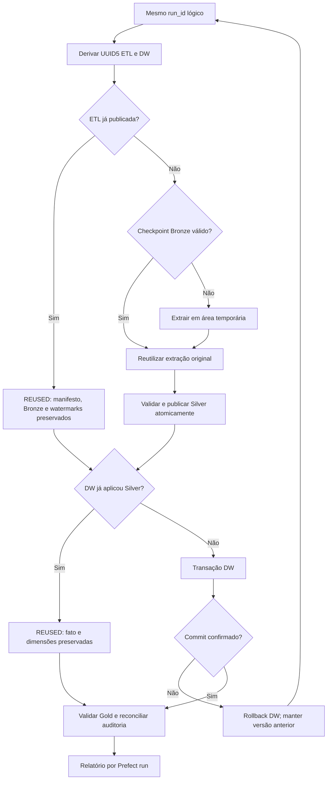

# Idempotência, retries e recuperação — Etapa 11.2

Esta validação não executa cargas nos destinos principais. Testes novos:
`tests/test_recovery.py`, com pytest e fixtures reutilizadas da ETL.
Prefect 3.9.1, pytest 9.2.0, Python 3.14. Componentes de produção não foram alterados.

## Replay e nova carga



O run_id lógico da Etapa 11.1 é d6cb127a-1507-4835-8bbd-0e3b79cf62f7.
Seus IDs ETL/DW são UUID5 determinísticos; um novo Prefect flow run possui outro UUID,
mesmo quando repete esse processamento lógico.
Não se deve usar UUID novo para chamar de replay: isso seria uma nova carga incremental.

O teste de replay copia os dados/controles e o DW concluídos para um diretório temporário.
Executa duas vezes o flow com aquele mesmo run_id, em outro servidor Prefect temporário.
A extração é instrumentada para falhar caso seja chamada: ambas passam pela rota REUSED real.
Compara versões, watermarks, arquivos Bronze/Silver, contagens, hashes das cinco tabelas e Gold.
Auditorias registram novas tentativas; isso é esperado e não é duplicação de dados de negócio.

## Retries

- Até três tentativas totais, sem retry integral automático do flow.
- Erro transitório controlado no adaptador da origem: duas falhas de conexão, sucesso na terceira.
- Indisponibilidade que continua: três tentativas, flow Failed e destinos preservados.
- Parquet candidato inválido: task Failed permanente, sem executar DW.
- O teste usa mocks de conexão ou um candidato inválido fora da publicação oficial; não derruba PostgreSQL.
- Na falha transitória, Prefect e adaptadores são reais; o mecanismo de indisponibilidade é injetado.

Erros esperados geram flow runs Failed no servidor de testes. O teste pytest passa ao demonstrar
que a falha foi bloqueada e a recuperação funcionou; isso não equivale a testes reprovados.

## Fronteiras testadas

| Fronteira | Antes da retomada | Retomada |
| --- | --- | --- |
| Extração concluída → publicação Bronze | Falha no os.replace, sem checkpoint/publicação oficial nova | Mesmo job extrai/publica corretamente |
| Transformação → publicação Silver | Falha before_publish; current.json e watermarks anteriores | Mesmo job reutiliza Bronze validada |
| Silver válida → início DW | Silver nova confirmada; DW anterior | ETL REUSED; DW aplica essa Silver |
| DW → antes do commit | Rollback das alterações DW | Mesmo job confirma a carga |
| DW → após commit, antes da confirmação | Dados já confirmados; auditoria pendente | REUSED reconcilia auditoria |
| Gold validada → auditoria final | Silver e DW válidos; flow Failed na finalização | Mesmo job preserva dados e refaz auditoria |

Para essas fronteiras, origem PostgreSQL e ETL/DW são reais, porém em schema/arquivos temporários.
Os pontos de falha são injetados só nos testes por mocks e hooks já existentes.
Não há parâmetro de injeção de falha exposto à CLI de produção.

Arquivos intermediários podem existir após interrupção. Somente current.json aponta a versão Silver oficial;
arquivos não referenciados não se tornam publicados. Não remova diretórios indiscriminadamente.

## Rollback e recuperação

Não existe transação distribuída entre manifesto Parquet e DuckDB:
- Falha antes de publicar Silver: manter publicação e watermarks anteriores.
- Falha após publicação Silver, antes do commit DW: manter Silver válida; DW permanece anterior.
- Falha depois do commit DW: reconciliar auditoria, sem desfazer o commit.
- Falha da auditoria final: registrar Failed no Prefect e retomar o mesmo job para completar o registro.

Não restaure um backup inteiro só porque a task de auditoria falhou.
A primeira opção é identificar a fronteira e retomar com o mesmo run_id e modo.
Se uma execução mais nova já publicou outra versão, a tentativa antiga não deve sobrepô-la;
use as guardas existentes e planeje uma nova carga.

Restauração de backup é medida excepcional: pare escritores/leitores, identifique o conjunto consistente
de manifesto/controles/arquivos referenciados e DW, valide checksums e proponha a restauração ao proprietário.
Não sobrescreva arquivos principais ou recue watermarks sem autorização específica.

## Concorrência

O teste dispara dois flow runs no servidor temporário: incremental mantém o guard enquanto
uma tentativa FULL incompatível é iniciada. A segunda falha antes de escrever datasets.
Após liberar a primeira, ela conclui sem duplicações ou mudanças de negócio.
Os guards são locks do SO por destino, não locks Python em memória.
Um lockfile existente não prova execução ativa; nunca o apague enquanto houver um escritor.
Não se garante coordenação distribuída entre máquinas/OneDrive.

## Executar os testes novos

Na raiz:

```powershell
.\.venv314\Scripts\python.exe -m pip install -r orchestration/requirements-dev.txt
```

Prepare um snapshot novo fora do projeto. O utilitário não executa cargas nem substitui backups:

```powershell
$snapshot = Join-Path $env:TEMP ('pastel-recovery-' + [guid]::NewGuid().ToString('N'))
.\.venv314\Scripts\python.exe -B -m orchestration.tests.prepare_snapshot --destination $snapshot
$env:PASTEL_RECOVERY_SNAPSHOT = $snapshot
$env:PREFECT_HOME = Join-Path $env:TEMP ('prefect-recovery-' + [guid]::NewGuid().ToString('N'))
$env:PREFECT_SERVER_ANALYTICS_ENABLED = "false"
.\.venv314\Scripts\python.exe -B -m pytest orchestration/tests/test_recovery.py -v
```

O Prefect Server principal precisa estar disponível para a verificação de concorrência do preparador;
o servidor dos testes é separado e temporário. O utilitário confere hashes, SQLite, ausência de WAL
e reconciliação Silver/DW. Sem snapshot explícito, os novos testes são pulados, em vez de escolher
automaticamente um destino principal. O perfil SNAPSHOT_READY.json registra schema de origem e ID lógico para o replay. O preparador identifica a execução correspondente à publicação atual; um snapshot legado pode precisar de PASTEL_REPLAY_RUN_ID explícito. Não remova a verificação do replay.

Não aponte a variável para a pasta de dados principal: os testes copiam o snapshot para outra fixture,
mas ele deve ser obtido consistentemente antes de iniciar. Nenhum deployment é registrado.
A fixture do teste real de ETL cria schema PostgreSQL próprio e o descarta no encerramento.
São necessárias permissões de CREATE SCHEMA; não use credenciais de produção.

[Resultados e evidências da execução](RECOVERY_VALIDATION.md).

## Suíte sem snapshot privado

O comando `python -B -m orchestration.tests.run_suite` cria seu próprio baseline isolado antes de executar as suítes. Prefira esse caminho para reproduzir a release em um clone novo. O preparador de snapshot acima continua disponível para investigar uma publicação local existente; não é necessário para os testes completos.

> Arquivos JSON de resultados citados são artefatos locais não distribuídos. O alcance da validação está resumido em ../docs/VALIDATION.md.
