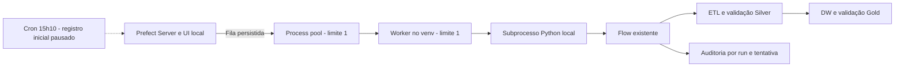

# Worker, agendamento e operação local — Etapa 11.3

Prefect 3.9.1, Python 3.14, Process Worker local no Windows.
O deployment usa o flow já existente. Não modifica ETL, regras comerciais ou tabelas do DW.
O caminho local do checkout é fornecido ao subprocesso; não é necessário publicar ou baixar código do GitHub.

## Arquitetura



Pool: pastel-da-casa-local-pool.
Deployment: pastel-da-casa-data-pipeline/pastel-da-casa-incremental-daily.
Cron: 10 15 * * *, timezone America/Sao_Paulo.
Parâmetros: mode=incremental, dry_run=false, validate_only=false,
allow_persistent=true, allow_full=false.
O parâmetro de persistência prepara cargas futuras autorizadas; não autoriza ativação de agenda por si só.

## 1. Ambiente e servidor

Na raiz, instale as dependências já declaradas em requirements.txt.
Em todos os terminais de operação:

```powershell
$env:PREFECT_HOME = (Join-Path (Get-Location) ".prefect")
$env:PREFECT_API_URL = "http://127.0.0.1:4200/api"
$env:PREFECT_SERVER_ANALYTICS_ENABLED = "false"
```

Em um terminal dedicado, se o servidor ainda não estiver aberto:

```powershell
.\.venv314\Scripts\prefect.exe server start --host 127.0.0.1 --port 4200
```

Não inicie outro servidor na mesma porta. UI: http://127.0.0.1:4200.
Nenhum perfil global é sobrescrito. .prefect/ e *.log são ignorados pelo Git.
A CLI operations exige API HTTP local explícita, sem credenciais na URL; não inicia servidor efêmero silenciosamente.

## 2. Pool e deployment pausado

Conferir o plano sem registrar:

```powershell
.\.venv314\Scripts\python.exe -m orchestration.operations plan
```

Registrar/criar ou atualizar o deployment **sempre pausado**, sem executar carga:

```powershell
.\.venv314\Scripts\python.exe -m orchestration.operations register
```

O comando cria o pool process se estiver ausente e aplica concorrência 1.
Não substitui pool existente de outro tipo nem muda silenciosamente deployment associado a outro pool.
Nome/slug fixos permitem atualizar sem duplicar o deployment ou o cron.
Repetir register pausa o deployment e registra seu schedule inativo novamente.
Não use esse comando para manter uma agenda previamente autorizada ativa.

O módulo antigo orchestration.deployment --serve continua disponível para o modo runner/serve.
Ele não é um Process Worker e não é necessário na nova operação. Evite registrar os dois modelos
para a mesma finalidade. Nenhum deployment legado foi criado nesta etapa.

## 3. Iniciar e encerrar worker

Em outro PowerShell, com as variáveis acima:

```powershell
.\.venv314\Scripts\python.exe -m orchestration.operations worker
```

O worker usa sys.executable do ambiente que iniciou o comando, diretório do projeto e PYTHONPATH local.
Mantém logs no terminal e os logs dos flows/tasks no Prefect.
Limite local 1; política de instalação never; não cria pools inesperadamente.
Não houve instalação de serviço Windows, tarefa agendada ou configuração de inicialização automática.

Para encerrar normalmente, pressione Ctrl+C no terminal do worker e aguarde a parada.
Prefira fazer isso quando não houver execução em andamento. Reinicie com o mesmo comando.
Não apague bancos, locks ou processos filhos para tentar “limpar” uma execução.

Para um polling de teste, com encerramento após processar o que estiver disponível:

```powershell
.\.venv314\Scripts\python.exe -m orchestration.operations worker --run-once
```

Na entrega, o worker local foi iniciado, executou a validação e terminou com código 0.
Ele **não permanece rodando em segundo plano**. O histórico mostra OFFLINE após encerrar/expirar heartbeat.
Para operação contínua, mantenha o PowerShell do worker aberto. Isso não ativa o cron.

## 4. Execução manual segura

O deployment pode estar pausado e ainda receber uma execução manual explícita.
Para criar somente um teste com leituras e três tasks:

```powershell
.\.venv314\Scripts\python.exe -m orchestration.operations safe-run --kind validate-only
```

Ou testar apenas o carregamento do flow/subprocesso, sem tasks de dados:

```powershell
.\.venv314\Scripts\python.exe -m orchestration.operations safe-run --kind dry-run
```

Ambos forçam allow_persistent=false e allow_full=false.
validate-only consulta PostgreSQL, Silver e Gold e não publica dados.
dry-run não conecta à origem e não altera datasets; o flow tem zero tasks de dados nesse modo.
O worker deve estar ativo; caso contrário o run fica Scheduled aguardando polling.
A CLI retorna flow_run_id e ID lógico para consulta.

Não use o botão genérico Run do deployment com os parâmetros padrão apenas para testar:
esses parâmetros representam uma carga incremental real futura e exigem autorização.
Para uma carga real manual autorizada, a CLI original em orchestration/README.md continua disponível;
ela não precisa do worker e não deve concorrer com os mesmos destinos.

## 5. Agendamento e fuso

O registro realizado nesta etapa tem duas proteções:
- deployment paused=true;
- único schedule active=false.

Não há próxima execução automática prevista enquanto essas condições forem mantidas.
15h10 é horário civil America/Sao_Paulo, não um deslocamento UTC fixo.
O scheduler usa a base IANA: cálculo conferido em 2017 (UTC-02) e 2026 (UTC-03),
mantendo 15h10 local. Atualize tzdata se houver mudança legal de fuso/DST.

Variáveis opcionais:
- PASTEL_CRON: padrão 10 15 * * *.
- PASTEL_TIMEZONE: padrão America/Sao_Paulo.
- PASTEL_WORK_POOL: padrão pastel-da-casa-local-pool.
- PASTEL_WORKER_NAME: padrão pastel-local-worker.
- PASTEL_DATA_DIR, PASTEL_DW_PATH, PASTEL_SOURCE_SCHEMA e opções de retry: configuração existente.

Depois de mudar configuração, registre novamente pausado e confira os destinos.
O worker recebe só as variáveis técnicas necessárias declaradas no job, além de seu ambiente local;
não grave senhas/tokens em job_variables. O backend/ETL continua lendo seu .env local já existente.

## 6. Ativação futura — exige autorização explícita

Somente depois de aprovar cargas recorrentes, revisar destinos/backups, fechar leitores DW e manter
PostgreSQL, Prefect Server, máquina e worker disponíveis:

```powershell
.\.venv314\Scripts\prefect.exe work-pool resume pastel-da-casa-local-pool
.\.venv314\Scripts\python.exe -m orchestration.operations schedule resume --authorize-recurring
```

Esse comando **não foi executado** na entrega. A flag é uma guarda técnica, não substitui autorização.
A validação exige um único schedule com o slug esperado e pool correto.
Ativar muda primeiro o schedule para active e, por último, libera o deployment.

Desativar novas programações:

```powershell
.\.venv314\Scripts\python.exe -m orchestration.operations schedule pause
```

Pausa não cancela execuções já criadas. Consulte Scheduled/Pending/Running antes de encerrar worker.
Não cancele nem mate um run em andamento indiscriminadamente. Em caso de cancelamento autorizado,
acompanhe o estado no Prefect e verifique os controles ETL/DW antes de retomar.

## 7. Monitoramento e alertas locais

```powershell
.\.venv314\Scripts\python.exe -m orchestration.monitor --limit 25
.\.venv314\Scripts\python.exe -m orchestration.monitor --alerts --limit 25
```

Consultas somente leitura: pool, limite, workers/heartbeat, deployment/schedule e histórico filtrado pelo flow.
Alertas incluem Failed, Crashed e Cancelled, tasks envolvidas, tentativas e duração.
Mensagens arbitrárias de exceções do servidor não são reproduzidas; consulte logs privados da task na UI.
A consulta é limitada a até 100 runs e 100 tasks por run; não é um serviço de notificações contínuo.
Não escreve no CRM/DW nem envia e-mail, WhatsApp, webhook ou outro canal.

Na UI:
- Runs: Completed, Running, Failed, Crashed, Cancelled e Scheduled.
- Dentro de um run: timeline, tasks, logs, duração, parâmetros e tentativas.
- Deployments: pool, parâmetros e único cron inativo.
- Work Pools/Workers: heartbeat/status e concorrência.

Novos nomes seguem pastel-<ambiente>-<modo>-<prefixo-id-lógico>.
Silver e status DW ficam no relatório data/orchestration/runs/<run_id>.json,
e no histórico por prefect_run_id, quando houve carga. validate-only não cria esses relatórios;
seus logs e estados ficam no Prefect.

Notificações externas futuras: após autorização, avaliar Automations/Blocks/webhooks suportados pela
versão instalada, definir destinatário e armazenar segredos fora do Git. Nenhum conector foi configurado.
O monitor local pode ser consultado periodicamente manualmente; não foi instalado agendador de alertas.

## 8. Concorrência e recuperação

Pool 1 + deployment 1 + worker 1 limitam processamento pelo worker.
Os locks existentes por destino continuam protegendo também contra FULL/incremental iniciados por CLI.
Não substituem leitores/escritores coordenados do DuckDB. Prefira disco local e um único host.

Teste isolado de reinicialização:
1. Worker processou dry-run e encerrou com código 0.
2. Outro dry-run foi enfileirado sem worker, permanecendo Scheduled e sem start_time.
3. Novo processo de worker reconheceu o mesmo deployment e concluiu o run.
4. O primeiro run permaneceu Completed no histórico; não houve duplicação de schedule.

Após reboot, inicie Docker/PostgreSQL, Prefect Server e worker manualmente.
Jobs persistidos no servidor podem aguardar o worker. Pausar o deployment afeta o scheduler,
não o processamento de runs manuais já na fila.
Se computador/worker cair durante uma carga, o estado pode ficar Running/Pending até detecção/intervenção;
não há promessa de retomada automática do processo Python interrompido.
Consulte locks, auditorias e fronteiras de commit; retome o mesmo ID lógico quando apropriado.
[Procedimento de recuperação e limites](RECOVERY.md).
A interrupção durante escrita/queda de energia não foi simulada nesta etapa: a reinicialização testada foi normal,
entre execuções seguras. Não foi interrompido PostgreSQL.

## 9. Troubleshooting

- API ausente: configure PREFECT_API_URL no terminal; confirme servidor/porta 4200.
- Run Scheduled sem progresso: worker pode estar offline, pool/queue pausado ou limite ocupado.
- Worker não encontra módulo: use a raiz correta, venv e deployment registrado deste checkout.
- Pasta renomeada: atualizar working_dir/job variables por register pausado, sem alterar dados.
- Erro de venv/dependências: reinstale requirements.txt no venv antes de reiniciar worker.
- DW bloqueado: fechar leitores e conferir escritores; não apagar .wal/.lock durante execução.
- Schedules duplicados/divergentes: a CLI de pausa/ativação recusa a operação; revisar na UI, sem exclusão automática.
- Worker OFFLINE após run-once: esperado; iniciar worker contínuo em terminal para voltar ao polling.
- Alertas vazios: nenhum run no filtro de falha, não significa monitoramento externo ativado.

## Testes e referências

```powershell
.\.venv314\Scripts\python.exe -m pip install -r orchestration/requirements-dev.txt
.\.venv314\Scripts\python.exe -B -m pytest orchestration/tests/test_operations.py -v
```

As integrações iniciam servidor Prefect temporário e workers reais de dry-run. Sem cargas principais.
[Relatório da Etapa 11.3](WORKER_VALIDATION.md).
API usada conferida na instalação e nas referências oficiais:
[Process Worker](https://reference.prefect.io/prefect/workers/process/) e
[RunnerDeployment](https://reference.prefect.io/prefect/deployments/runner/).


## Estado após a Etapa 11.4

O pool principal também foi pausado para impedir execução de pendências enquanto se aguarda nova autorização. Antes de retomar, confirme que não há runs antigos Scheduled/Late/Pending/Running; não os cancele nem execute automaticamente. Após autorização explícita, liberar pool e cron como mostrado acima, aguardando a próxima ocorrência futura. [Diagnóstico e evidências](AUTOMATION_VALIDATION.md).

Uma validação reproduzível de scheduling separado está em `python -m orchestration.scheduling_probe`: exige principal/pool pausados, cria snapshot/backup únicos, aguarda o scheduler e usa somente validate-only em destinos temporários. Ao encerrar, pausa o pool/deployment/schedule de teste e preserva os logs. Se o processo for morto antes do finally, confira a pausa desse teste na UI; seus parâmetros nunca autorizam carga.


## Atualização operacional — Etapa 11.5

A pausa descrita na Etapa 11.4 foi revertida somente após confirmação do proprietário. Estado observado em 05/11/2026: worker ONLINE, pool READY, deployment ativo e cron de 15h10 ativo. [Primeira carga automática comprovada](FIRST_AUTOMATIC_RUN.md). O monitor inclui auto_scheduled e horário esperado para diferenciar execução automática de manual.

## Estado após a validação automática

O procedimento acima cria deployments pausados em instalações novas. No ambiente local a ativação foi autorizada e a primeira carga automática foi validada; veja [evidência](FIRST_AUTOMATIC_RUN.md). Não repita `register` para manter a agenda ativa, pois ele a pausa. Esta release não altera o cron ativo nem encerra o worker.

> Arquivos JSON de resultados citados são artefatos locais não distribuídos. O alcance da validação está resumido em ../docs/VALIDATION.md.
