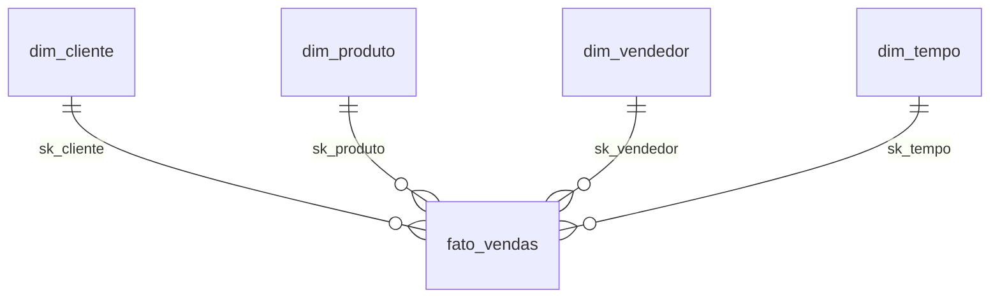

# Pastel da Casa — Data Warehouse DuckDB (Etapa 08)

DW local sobre **publicações Silver validadas**, sem conexão PostgreSQL, API ou
Bronze. Modelo dimensional SCD Type 1, fato por item faturado e views Gold SQL.

**Estado atual (2026-11-05): DW persistente carregado; views Gold da Etapa 09 atualizadas após autorização.**

As medições abaixo registram a validação original da Etapa 08.
Os testes usam bancos temporários. Uma integração adicional com a Silver real
também usou um arquivo temporário removido ao final.

## Instalação e estrutura

```powershell
.\.venv314\Scripts\python.exe -m pip install -r warehouse/requirements.txt
```

DuckDB 2.0.0 está fixado para reprodutibilidade; pytz é usado pela integração Python
para timestamps com fuso. PyArrow valida os contratos Parquet. Não é necessário
alterar .env, Docker Compose, backend, frontend ou ETL.

| Arquivo | Responsabilidade |
| --- | --- |
| config.py | Caminhos locais |
| source.py | Fixar manifesto, validar checksums/contratos e materializar Silver |
| model.py | Dimensões, SKs e reconciliação por chave |
| quality.py | Integridade, finanças e comparação fonte/destino |
| loader.py | Transação, auditoria, rollback e controle de versão |
| sql/001_schema.sql | DDL das dimensões, fato e controles |
| sql/002_gold.sql | Indicadores e rankings |
| sql/examples.sql | Consultas de exemplo |
| tests/ | Publicações Silver fictícias e DWs temporários |

Padrões:
- Silver: data/control/current.json e Parquets referenciados em data/silver/.
- DW: data/warehouse/pastel_da_casa.duckdb.
- Logs/lock: data/warehouse/pastel_da_casa.duckdb.control/.
- Auditoria: tabela dw_runs dentro do DuckDB.

data/ e arquivos .duckdb/.wal/controles locais são ignorados pelo Git.

## Modelo dimensional



Grão de fato_vendas: **uma linha por id_item de pedido FATURADO**.
id_item é único; id_pedido permanece para agrupar vários itens do mesmo pedido.
Clientes/produtos/vendedores inativos com vendas históricas continuam válidos.

As SKs são BIGINT independentes dos IDs CRM, alocadas para novos IDs e preservadas
em atualizações e FULLs posteriores. dim_tempo usa uma SK independente e a data
como chave natural. Não são reiniciadas sequências CRM; o DW sequer acessa o CRM.

### Dicionário das dimensões

| Tabela | Chave substituta | Identificador original/natural | Atributos |
| --- | --- | --- | --- |
| dim_cliente | sk_cliente BIGINT | id_cliente BIGINT UNIQUE | razao_social, cnpj, cidade, uf VARCHAR; ativo BOOLEAN; created_at/updated_at TIMESTAMPTZ |
| dim_produto | sk_produto BIGINT | id_produto BIGINT UNIQUE | nome VARCHAR; peso_gramas/estoque_atual INTEGER; preco_catalogo DECIMAL(12,2); ativo BOOLEAN; created_at/updated_at TIMESTAMPTZ |
| dim_vendedor | sk_vendedor BIGINT | id_vendedor BIGINT UNIQUE | nome/email VARCHAR; ativo BOOLEAN; created_at/updated_at TIMESTAMPTZ |
| dim_tempo | sk_tempo BIGINT | data DATE UNIQUE | ano, mes, dia, trimestre, dia_semana INTEGER; ano_mes/mes_nome/dia_semana_nome VARCHAR; fim_de_semana BOOLEAN |

Todas têm row_hash, presente_na_silver, loaded_version, dw_created_at e dw_updated_at.
O calendário é contínuo entre menor e maior data_pedido da Silver, considerando
todos os status, em UTC. Pode incluir datas de operações originais além do período
das cargas sintéticas; no teste com a Silver atual foram 366 dias.

SCD Type 1: atributos anteriores são substituídos, sem uma linha por versão do
cadastro. UF/cidade/nome atuais serão usados para analisar também vendas antigas.
Se for necessária a geografia do momento da venda, isso exigirá outro modelo
(ex.: SCD2), fora desta etapa.

IDs que desaparecem da Silver têm presente_na_silver=false; seu mapeamento de SK
é retido e reaproveitado se retornarem. Não são criadas versões SCD2. Somente
dimensões presentes podem ser referenciadas pela fato corrente.

### Dicionário da fato

| Colunas | Tipo/regra |
| --- | --- |
| id_item | BIGINT PRIMARY KEY; ID original do item |
| id_pedido | BIGINT; identifica o pedido, não é único na fato |
| id_cliente, id_produto, id_vendedor | BIGINT; rastreabilidade aos IDs CRM |
| sk_cliente, sk_produto, sk_vendedor, sk_tempo | BIGINT com FKs para as dimensões |
| data_pedido | TIMESTAMPTZ; calendário interpretado em UTC |
| quantidade | INTEGER > 0 |
| preco_unitario | DECIMAL(12,2), preço histórico do item |
| desconto | DECIMAL(12,2), desconto total daquele item |
| valor_bruto | DECIMAL(38,2) = quantidade × preco_unitario |
| valor_liquido | DECIMAL(38,2) = valor_bruto - desconto |
| source_updated_at | TIMESTAMPTZ; atualização da origem Silver derivada |
| row_hash | SHA-256 dos atributos reconciliados |
| loaded_version | Versão Silver que inseriu/alterou aquela linha |
| dw_created_at, dw_updated_at | TIMESTAMPTZ, auditoria do DW |

preco_catalogo nunca substitui preco_unitario. total_pedido da Silver é usado na
validação, mas não é armazenado como medida repetida para ser somado indevidamente.

## FULL e INCREMENTAL

Primeiro, exiba o plano sem criar o banco:

```powershell
.\.venv314\Scripts\python.exe -m warehouse --mode full
```

**Somente após autorização para persistir o DW:**

```powershell
.\.venv314\Scripts\python.exe -m warehouse --mode full --execute --allow-persistent
```

Depois da primeira carga:

```powershell
.\.venv314\Scripts\python.exe -m warehouse --mode incremental --execute --allow-persistent
```

--silver-root e --database permitem outros diretórios locais.
--run-id pode registrar uma identificação UUID fornecida; cada tentativa tem seu
attempt_id próprio. Sem --execute não há carga; com --execute a CLI também exige
--allow-persistent. A flag é confirmação técnica e não substitui autorização.

FULL constrói o modelo completo a partir do snapshot Silver, inclusive ao
reconciliar um DW existente. Não usa DROP/TRUNCATE nem renumera SKs para reconstruir.
INCREMENTAL exige uma FULL anterior, detecta a versão publicada e reconcilia
snapshots por ID: só atualiza linhas cujo hash de atributos mudou, inclui IDs novos
e remove da fato itens que não pertencem mais às vendas faturadas aceitas.

Ambos leem o snapshot completo Silver; não são CDC. A ausência de versão nova
retorna REUSED depois de validar origem/destino, sem escrever dimensões/fato
ou avançar dw_state. Nova publicação sem mudanças de negócio avança apenas o
controle e audita zero inserções/atualizações.

O manifesto é fixado uma vez. Só os sete Parquets Silver declarados são lidos,
com checksum/tamanho/schema/contagem conferidos. Arquivos em staging não entram.
Uma nova publicação da ETL durante a carga não mistura os arquivos já fixados.
Antes do commit, os checksums são conferidos novamente.

Não é permitido regredir para snapshot/publicação mais antiga nem trocar a origem
de uma base DW existente. Uma versão Silver repetida com conteúdo diferente é erro.
Uma falha é retomada repetindo o comando: a publicação ATUAL será reavaliada; se a
ETL publicou uma versão mais nova, ela será o novo alvo. Não há checkpoint parcial
de dimensões para aplicar fora de transação.

## Transação e auditoria

Dimensões, fato, views Gold e dw_state são confirmados na **mesma transação DuckDB**.
Qualquer falha antes do commit faz rollback de dados e do controle de versão.

dw_runs é auditada fora da transação de dados para preservar tentativas com erro.
Registra run_id, attempt_id, modo, silver_version, início/fim UTC, duração, status,
mensagem, métricas por tabela e resultados das validações. Métricas incluem
processed/inserted/updated e removed ou marked_absent.

Falha depois do commit e antes da auditoria é marcada PUBLISHED_AUDIT_PENDING;
a repetição valida a publicação já confirmada e reconcilia esse estado.
O marcador de sucesso de dados é dw_state, não um log isolado de início.

Somente um escritor por arquivo é permitido, com lock local e proteção nativa do
DuckDB. Não é uma coordenação distribuída. Leitores/processos concorrentes podem
encontrar bloqueio de arquivo: fechar as conexões antes de outra carga.

## Qualidade

Antes da carga:
- Publicação existente e declarada, arquivos Silver imutáveis, contratos e contagens.
- PKs únicas/não nulas/positivas, IDs naturais de itens sem repetição por produto.
- FKs das seis tabelas e auditoria created_at/updated_at.
- Quantidades positivas, preços/descontos e estoque válidos.
- Saídas compatíveis com os itens faturados e sem duplicação.
- vendas_detalhadas reconciliada por item com pedidos/itens Silver e seus totais.

Depois da reconciliação, ainda na transação:
- SKs/IDs únicos, dimensões presentes e FKs da fato.
- Comparação dos atributos por chave contra o staging.
- Valores bruto/líquido, datas UTC e preços históricos.
- Contagem de itens, pedidos faturados e soma líquida iguais à Silver.

O DW não corrige nem altera o lake/CRM. Qualquer inconsistência faz a carga falhar,
com mensagem e rollback, em vez de eliminar linhas silenciosamente.

## Gold: fórmulas

| View | Regra |
| --- | --- |
| gold_kpis / gold_faturamento_total | SUM(valor_liquido) |
| gold_pedidos_faturados | COUNT(DISTINCT id_pedido) |
| gold_ticket_medio | Receita / pedidos distintos, arredondada a centavos |
| gold_faturamento_mensal | Receita e pedidos distintos por ano/mês UTC |
| gold_produtos_mais_vendidos | SUM(quantidade), receita e ranking de unidades |
| gold_faturamento_uf | Receita e pedidos por UF atual do cliente (SCD1) |
| gold_ranking_vendedores | Receita/pedidos por vendedor, ranking de receita |
| gold_clientes_recorrentes | Clientes com >= 2 pedidos distintos faturados |

As views só consultam fato_vendas (já restrita a faturados) e dimensões 1:1 por SK.
Não somam total_pedido por item. O ticket usa aritmética inteira de centavos e
arredondamento half-up para valores não negativos, convertido a DECIMAL(38,2),
porque a divisão DECIMAL do DuckDB é aproximada.

Consultas de exemplo:

```sql
SELECT * FROM gold_kpis;
SELECT * FROM gold_faturamento_mensal ORDER BY ano,mes;
SELECT * FROM gold_produtos_mais_vendidos ORDER BY posicao,id_produto LIMIT 10;
SELECT * FROM gold_faturamento_uf ORDER BY faturamento DESC;
SELECT * FROM gold_clientes_recorrentes ORDER BY faturamento DESC;
SELECT * FROM dw_runs ORDER BY started_at DESC LIMIT 10;
```

Exemplo Python, depois da carga autorizada:

```python
import duckdb
with duckdb.connect("data/warehouse/pastel_da_casa.duckdb", read_only=True) as con:
    print(con.execute("SELECT * FROM gold_kpis").fetchall())
```

Mais consultas em sql/examples.sql. O dashboard visual está em frontend/analytics/ (Etapa 09).

## Testes e resultado

```powershell
.\.venv314\Scripts\python.exe -m unittest discover -s warehouse/tests -v
```

Foram aprovados 25 testes isolados, sem PostgreSQL: dimensões, fato, chaves,
preço histórico, finanças, todos os indicadores, SCD1, novas dimensões/vendas,
status, reuso, ausência de mudanças, rollback, auditoria pós-commit, checksums,
manifesto, arquivos não publicados e proteção da CLI.

Uma integração adicional usou a Silver real, mas carregou somente um DuckDB em
diretório temporário e o removeu ao final. Resultado: 1001 clientes, 50 produtos,
30 vendedores, 366 datas, 44939 itens faturados, 14998 pedidos e R$ 14.420.828,23.
Ticket médio: R$ 961,52. A repetição retornou REUSED. A Silver permaneceu intacta.

A validação original não criou o arquivo persistente; posteriormente ele foi carregado e as views da Etapa 09 foram autorizadas e publicadas. Consulte
VALIDATION_REPORT.md e validation_report.json como registros históricos.

## Limites

- SCD1 não preserva versões antigas dos atributos cadastrais dentro do DW.
- Snapshots Silver completos são lidos e reconciliados; não há CDC/streaming.
- Fatos que deixam de existir na Silver faturada são removidos apenas da fato
  analítica, com contagem auditada. Históricos de origem continuam nos Parquets
  versionados. Dimensões ausentes retêm o mapeamento de SK.
- Um único host/escritor, sem publicação distribuída ou agendamento.
- Modelo versão 1: mudanças futuras do schema exigem migração explícita.
- Cargas persistentes exigem autorização; a existência do DW local não dispensa os passos de instalação em uma máquina nova.


## Etapa 09 — Inteligência Comercial

Dashboard analítico Streamlit com consultas somente leitura às views Gold, filtros SQL, Plotly e paginação. [Execução, indicadores e atualização do DW](../frontend/analytics/README.md). As duas novas views foram atualizadas após autorização em 2026-11-05; a interface não executa cargas.

> Arquivos JSON de resultados citados são artefatos locais não distribuídos. O alcance da validação está resumido em ../docs/VALIDATION.md.
